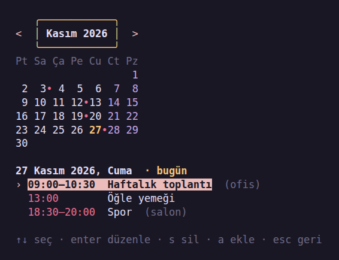

# takvim

Terminalde akan, tamamen klavyeyle kullanılan sade bir takvim.



## Kurulum

```bash
python3 -m venv .venv
.venv/bin/pip install -e ".[server]"
```

## Çalıştırma

```bash
.venv/bin/takvim-server   # sunucu (açık kalsın)
.venv/bin/takvim          # uygulama
```

Başka bir sunucuya bağlanmak için: `TAKVIM_SERVER=https://... takvim`

## Tuşlar

- `←↑↓→` gün seç (ay kenarında `←→` önceki/sonraki aya geçer, ilk haftada `↑` ay oklarına çıkar)
- `enter` o günün planları · `a` ekle · `t` bugün · `ç` çıkış yap · `q` kapat
- Planlarda: `↑↓` seç · `enter` düzenle · `s` sil · `esc` geri

Renk paleti: `TAKVIM_TEMA=orman|toprak|gul|lavanta|sade` (önizleme: `python -m takvim.temalar`)
